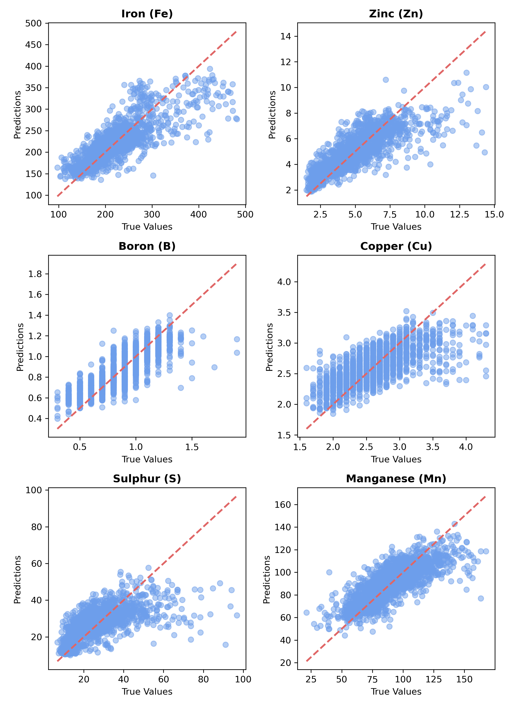
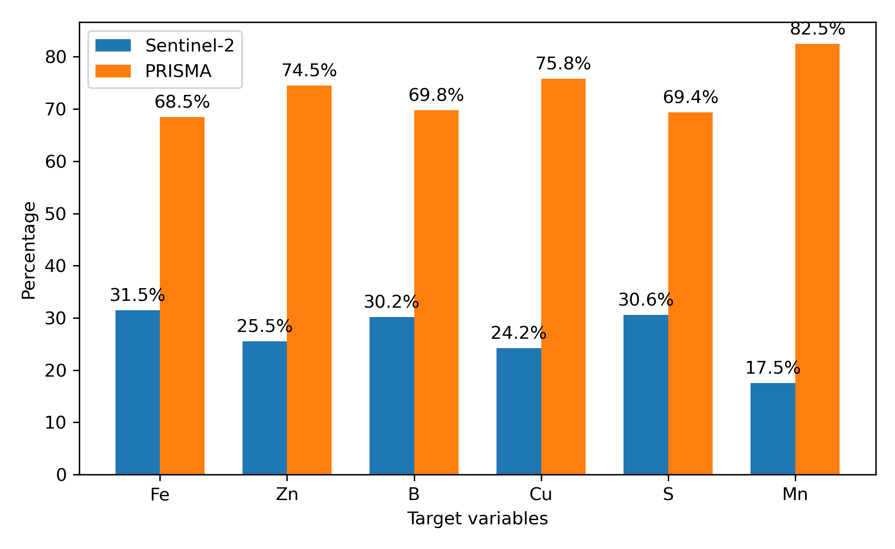

# 🛰️ HYPERVIEW2: soil nutrients from satellite spectra, with explainable AI

This repository estimates six soil nutrients (B, Cu, Zn, Fe, S, Mn) for farm fields from Sentinel-2 and PRISMA satellite imagery, and explains the model's predictions with SHAP.

It is a fork of the **first-place solution to the HYPERVIEW2 challenge by Aaron Banze (team *HypeSpectral*)**, reorganized so that the results are easier to reproduce and build on.

## Credit

The method and essentially all of the modelling and XAI code are the work of the original author. The 🥇 first place belongs to his entry, not to this fork.

- **Original repository:** [a-banze/hyperview2_hype-spectral](https://github.com/a-banze/hyperview2_hype-spectral)
- **Author:** Aaron Banze, German Aerospace Center (DLR) and University of the Bundeswehr Munich
- **Method write-up:** [Hype-Spectral: A Top-Performing Solution for Soil Properties Estimation from Satellite Imagery](https://connect.helmholtz-imaging.de/blog_gallery/blogpost/13)
- **Challenge:** [HYPERVIEW2](https://platform.ai4eo.eu/hyperview2), organized by ESA Φ-lab and KP Labs as part of the EASi workshop at ECAI 2025
- **Original acknowledgement:** the work was supported by the HYPER-AMPLIFAI project funded by the Helmholtz Association of German Research Centres (HGF) under Contract ZT-I-PF-4-056.

What this fork changes:

- a consistent folder layout (`notebooks/`, `src/`, `data/`, `models/`, `figures/`, `outputs/`) and numbered notebooks;
- a data-download notebook (`00_download_data.ipynb`);
- paths that resolve automatically from the repository root, so no placeholders need editing;
- an `environment.yml` and a `.gitignore` that keeps the dataset, models and run outputs out of git;
- renamed figures. The modelling steps themselves are unchanged.

The original repository does not include a license file, and this fork does not add one. If you want to reuse the code outside GitHub, ask the original author.

## The task

The HYPERVIEW2 challenge had two phases:

1. build a model with the best prediction performance;
2. design XAI methods to assess the model's robustness.

Predictions are scored per element as the model's mean squared error divided by that of a baseline that always predicts the training mean. The final score is the average over the six elements, so 1.0 means "no better than the mean" and lower is better.

## Method in brief

1. Average each field's image patch into one spectrum per sensor (PRISMA: 230 bands, Sentinel-2: 12 bands).
2. Remove PRISMA water-absorption bands (about 1328–1523 nm and 1812–2044 nm) for Fe, Zn, Cu and S.
3. Standardize Sentinel-2, then compress with PCA (12 components for Sentinel-2, 20 for PRISMA).
4. Add back a few hand-picked raw PRISMA bands per element.
5. Select 28–33 features per element with recursive feature elimination.
6. Fit one Extra Trees regressor per element, with a grid search over its hyperparameters.
7. Explain the full pipeline (raw bands in, prediction out) with permutation SHAP, and test how the explanations change when noise is added to the inputs.

## Repository layout

```
├── notebooks/
│   ├── 00_download_data.ipynb     download the dataset from EOTDL
│   ├── 01_explore_data.ipynb      targets, example patches, band–target correlations
│   ├── 02_train_model.ipynb       preprocessing, feature selection, training, validation, submission
│   └── 03_explain_model.ipynb     SHAP band and sensor importance, noise sensitivity
├── src/
│   ├── data_loading.py            loads the patches and labels; mean-value baseline
│   └── predict_pipeline.py        wraps preprocessing + model into one predict function (used by 03)
├── data/
│   ├── wavelengths.json           centre wavelength of every band
│   └── hyperview2/                the dataset (not in git, see step 3)
├── models/                        saved models and preprocessing objects (not in git)
├── figures/                       figures written by the notebooks
├── outputs/                       submission.csv, metrics and result tables (not in git)
└── environment.yml
```

## Reproduce the results

### 1. Get the code

```bash
git clone https://github.com/shouyongpeng/hyperview2_hyperspectral_xai.git
cd hyperview2_hyperspectral_xai
```

### 2. Create the environment

```bash
conda env create -f environment.yml
conda activate hyperview2
```

The original code notes Python 3.10.17 and scikit-learn 1.6.1; `environment.yml` pins those two and leaves the other packages unpinned.

### 3. Download the dataset

The data is hosted on the [Earth Observation Training Data Lab (EOTDL)](https://www.eotdl.com/datasets/HYPERVIEW2). You need a free EOTDL account. The download is about 330 MB.

Either run `notebooks/00_download_data.ipynb`, or do the same from a terminal in the repository root:

```bash
pip install eotdl
eotdl auth login
eotdl datasets get HYPERVIEW2 --assets -f --path data
mv data/HYPERVIEW2 data/_hyperview2_tmp && mv data/_hyperview2_tmp data/hyperview2
```

`--assets` is required: without it only the catalog is downloaded. Afterwards `data/hyperview2/` should contain `train/`, `test/` and `train_gt.csv`, with 9,404 `.npz` files in total (1,876 training fields and 1,888 test fields).

The dataset is released for non-commercial use. Do not commit it.

### 4. Run the notebooks in order

```bash
jupyter lab
```

Open the notebooks from the `notebooks/` folder. Each one finds the repository root by itself.

| Notebook | What it produces | Notes |
|---|---|---|
| `01_explore_data` | `figures/explore_*.png` | Fast (under a minute). |
| `02_train_model` | cross-validation scores, `figures/train_predictions_vs_truth.png`, `outputs/submission.csv`, `outputs/metrics_table.tex` | Slow: the grid search and validation fit thousands of 5,000-tree models. Expect hours. |
| `03_explain_model` | `figures/xai_*.png`, `outputs/xai_noise_results.csv` | Slow: the stored outputs show about 12 minutes per SHAP pass, and there are 24 passes. Needs saved models, see below. |

### Known gaps

- **`02_train_model` does not save the models that `03_explain_model` loads.** Notebook 03 expects these files in `models/`: `ExtraTrees_models_dict.pkl`, `best_features_indices_dict.pkl`, `msi_scaler.pkl`, `pca_msi.pkl`, `pca_hsi.pkl` and `pca_hsi_filtered.pkl`. They are not in the original repository either. Until notebook 02 writes them, notebook 03 cannot run end to end.
- **The order of the hand-picked raw PRISMA bands differs** between `02_train_model` and `src/predict_pipeline.py`. Models saved from notebook 02 must use the same column order as the pipeline.
- **The cross-validation score is optimistic.** PCA, feature selection and hyperparameters are chosen on the whole training set before the folds are split. The only independent number is the organisers' score on the hidden test labels.
- **Test labels are not public,** so `outputs/submission.csv` cannot be scored locally.

## Ideas for improving the results

None of these have been tried in this repository.

**Make the evaluation trustworthy first**

- Put scaling, PCA and feature selection inside each cross-validation fold, and tune hyperparameters with nested cross-validation.
- If field locations can be obtained, split folds by area, since neighbouring fields are likely to be similar.

**Make the pipeline reproducible end to end**

- Save the fitted scaler, PCAs, selected features and models from notebook 02 into `models/`.
- Pin every package version once a working environment is confirmed.

**Modelling**

- Field statistics beyond the mean (median, spread, percentiles), and use of the soil mask for PRISMA, where it is currently ignored.
- The airborne hyperspectral images, which exist for training fields only and are currently unused.
- Transforming the skewed targets (Fe, Zn and S have long right tails) before fitting.
- Other regressors or an ensemble alongside Extra Trees.

**Explainability**

- Report SHAP for groups of neighbouring bands, since adjacent wavelengths are highly correlated and share credit.
- Check that conclusions are stable across SHAP sampling budgets and background samples.

## Results from the original work

Cross-validated predictions against laboratory values, and the share of SHAP importance carried by each sensor:




